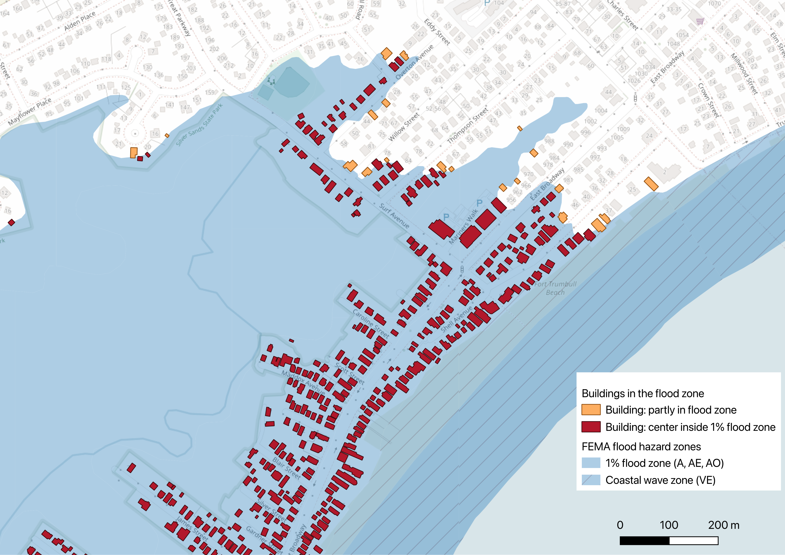
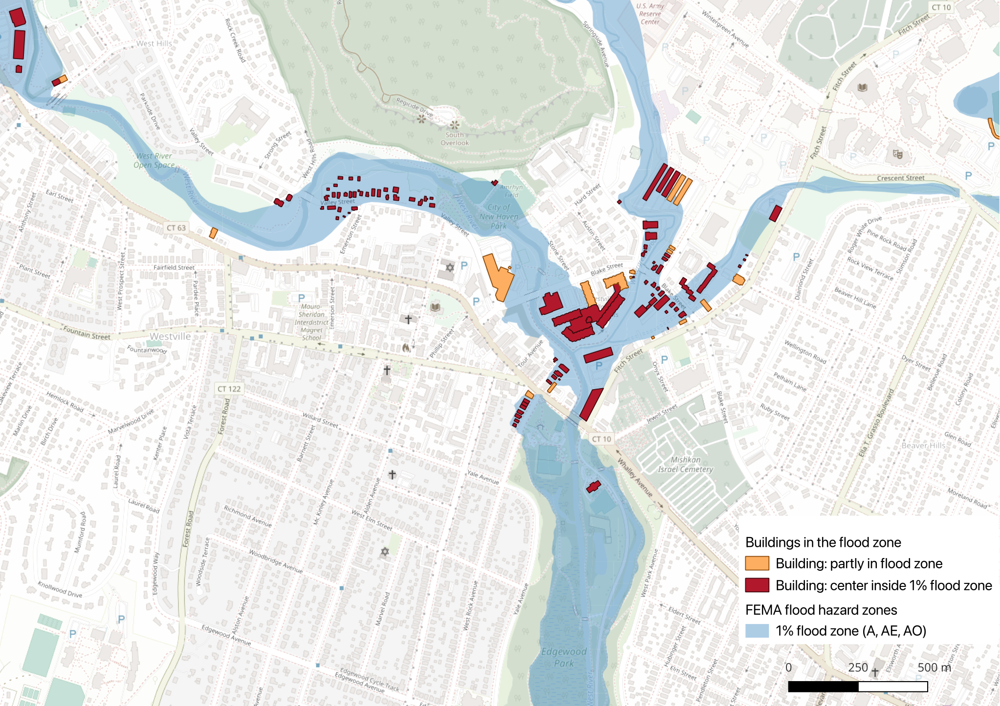
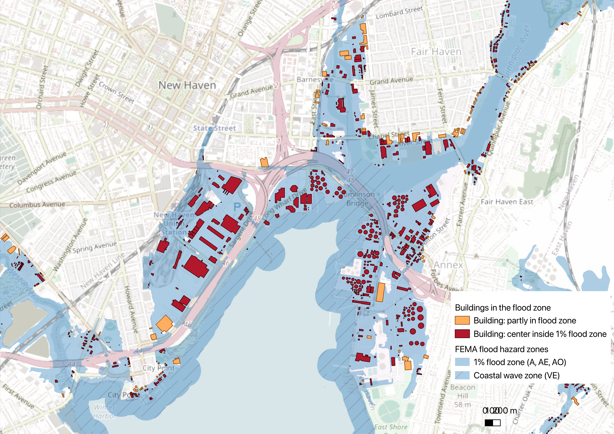

# Buildings in FEMA flood zones (New Haven County, Connecticut)

Phase 1 of my [cloud-native geospatial portfolio](../README.md). November 2026.

## Summary

How many buildings in New Haven County, Connecticut, are located in FEMA's high-risk flood zone?
I combined FEMA's flood maps with building footprints from Overture Maps and ran the analysis on a
laptop, where the whole county takes under a second. Splitting FEMA's flood polygons into small
pieces made that comparison about 100 times faster than using the shapefiles as FEMA publishes them,
with identical results. Between 13,000 and 16,000 of the county's 333,000 buildings are in the
1%-annual-chance flood zone. The range depends on whether any part of a building touches
the zone or only its center; about 3,000 buildings fall in between. Along the
shoreline, 460 homes are situated in FEMA's highest-risk coastal wave zone.

*Buildings in FEMA's 1% flood zone at Fort Trumbull Beach and Silver Sands State Park, Milford, CT.
Dark red: a point inside the footprint is in the 1% zone. Orange: the building only partly touches it.
Hatching marks FEMA's coastal wave zone (VE). Made in QGIS.
Data: FEMA NFHL; Overture Maps (OpenStreetMap, Microsoft). Basemap © OpenStreetMap contributors.*

## Key findings

- **13,000 to 16,000 buildings** (3.9% to 4.8% of 333,000) are in the 1%-annual-chance flood zone,
  FEMA's Special Flood Hazard Area, where flood insurance is required for federally backed mortgages.
  Another 3,700 to 4,200 are in the 0.2% zone.
- **About 3,000 buildings are edge cases.** The floodplain clips part of the footprint but not its
  interior. Which number to report depends on the question: an insurer or emergency planner would
  want the upper bound, and a planning or assessment report would more likely use the stricter rule.
- **1,361 buildings touch FEMA's coastal wave zone (VE)**, where flooding comes with waves of 3 feet
  or more. 460 are homes; 884 (65%) have no building type recorded in the source data.
- **Floodplains reach well inland.** On the map, whole neighborhoods around the Silver Sands marsh
  are in the 1% zone even though they sit back from the beach.
- **Critical infrastructure is exposed, not just homes:** the rail yard near Union Station and port
  facilities around New Haven Harbor sit in the 1% zone.
- **$2.9 to $3.7 billion in assessed building value** (structures only, not land) sits on parcels
  in the 1% flood zone, and $0.4 billion in the coastal wave zone (see [What's at risk](#whats-at-risk)).

| How a building counts as "in" the zone | 1% flood zone | 0.2% flood zone |
| --- | --- | --- |
| Any part of the footprint touches it ([count_by_risk.sql](count_by_risk.sql)) | 15,958 (4.8%) | 4,207 (1.3%) |
| A point inside the footprint is in it ([count_by_risk_point.sql](count_by_risk_point.sql)) | 12,953 (3.9%) | 3,693 (1.1%) |

Each building is counted once, under its highest risk. Results:
[results_by_risk.csv](results_by_risk.csv), [results_by_risk_point.csv](results_by_risk_point.csv).

## What's at risk

Connecticut's town assessor records ([Connecticut CAMA and Parcel Layer 2025](https://catalog.data.gov/dataset/connecticut-cama-and-parcel-layer-2025)) add building use, value and age. 97.8% of the
at-risk buildings matched a parcel with assessor data.

Assessor records value each parcel in two parts: the **land** and the **buildings** on it. This
report leads with **building value**, because floods damage structures, not land. **Total parcel
value** (land plus buildings) is shown for comparison only:

| Value on parcels in the 1% flood zone | Strict rule | Touch rule | Coastal wave zone (VE) |
| --- | --- | --- | --- |
| **Building value** (structures only), the headline | **$2.86B** | **$3.71B** | **$0.41B** |
| Total parcel value (land plus buildings) | $6.07B | $7.45B | $1.28B |

Connecticut assesses property at 70% of market value, so the building value is roughly $4.1 to
$5.3 billion at market.

- **Use:** homes are most of it, but commercial and public property are large too. Four of the ten
  most valuable at-risk parcels (by total parcel value) are public schools.
- **Place:** New Haven ($597M in building value), Milford ($526M), Branford ($456M), Madison ($351M)
  and West Haven ($282M) lead ([results_by_town.csv](results_by_town.csv)).
- **Age:** 81% of at-risk buildings with a known build year (11,721 of 14,541) were built before
  1980, and 39% between 1900 and 1949. Most likely predate modern floodplain building standards
  ([results_by_period_built.csv](results_by_period_built.csv)).

| Use | At-risk buildings | Building value, touch rule | Building value, strict rule | Building value in wave zone (VE) |
| --- | --- | --- | --- | --- |
| Residential: single-family and other | 11,071 | $1,620M | $1,289M | $290M |
| Commercial | 1,745 | $813M | $592M | $44M |
| Government and tax-exempt | 856 | $745M | $579M | $26M |
| Residential: multi-family | 952 | $281M | $223M | $23M |
| Industrial | 561 | $171M | $128M | $30M |
| Other (vacant, farm, recreation) | 229 | $70M | $38M | $0M |
| Residential: condominium | 123 | $14M | $10M | $1M |
| **Total** | **15,537** | **$3,714M** | **$2,859M** | **$415M** |

Assessed building value (structures only), counted once per parcel ([results_by_use.csv](results_by_use.csv)). 67 matched
buildings have a parcel with no use code and are left out of the table.

**How buildings were matched to parcels** ([join_parcels.sql](join_parcels.sql)):

- A building belongs to the parcel that holds the largest share of its footprint. Near-ties (within
  5 percentage points) go to the parcel with assessor data, then the smaller parcel.
- If that parcel has no assessor data, the building gets none rather than borrowing a neighbor's
  value. This left 79 buildings that sit mostly in an empty overlapping parcel unmatched.
- Values are summed once per parcel, so a house and its garage do not count the lot twice.
- Total parcel value is much higher than building value partly because of a few large public
  parcels: the ten most valuable (a water utility site, state land, schools, a power plant) hold
  14% of the $7.45 billion total, mostly in land. The #1 parcel is worth $263 million with no
  building value at all.

## More maps

*West River, Westville, New Haven. The 1% flood zone follows the river miles inland, through
residential streets and around commercial buildings. Dark red: center inside the 1% zone. Orange:
partly in the zone. Data: FEMA NFHL; Overture Maps (OpenStreetMap, Microsoft). Basemap © OpenStreetMap contributors.*

*New Haven Harbor. The rail yard near Union Station, Long Wharf and port facilities on both shores,
including what appear to be fuel storage tanks, sit in the 1% flood zone next to the coastal wave
zone (hatched). Dark red: center inside the 1% zone. Orange: partly in the zone. Data: FEMA NFHL; Overture Maps (OpenStreetMap, Microsoft). Basemap © OpenStreetMap contributors.*

## Why this approach

FEMA publishes its National Flood Hazard Layer as 2,670 zipped county shapefiles (88.9 GB
nationally) with no API. In a typical desktop GIS workflow, this means downloading and unzipping
county shapefiles, loading a building layer and running a manual select-by-location, then repeating
it all when FEMA updates its maps. Here the whole pipeline is scripted: the buildings download in
8 seconds, and the county-wide comparison reruns in under a second.

A big part of the speed comes from the shape of the data. FEMA's flood polygons can be enormous,
with the largest in New Haven County at 160,383 vertices, so every nearby building is tested
against thousands of edges. Splitting them into pieces of at most 100 vertices gives the same
answer much faster ([benchmark_subdivide.sql](benchmark_subdivide.sql)):

| Flood zones used | Buildings touching the 1% zone | Time |
| --- | --- | --- |
| FEMA's original polygons (6,881 shapes) | 15,958 | 7.4 s |
| Subdivided pieces (41,157, at most 100 vertices) | 15,958 | 0.07 s |

The parcel data showed the same gap in data delivery. Connecticut publishes its parcels through
a web service that returns 2,000 records per request; getting New Haven County's 284,920 parcels
took about 35 minutes, with retries for server errors. Overture's 582,882 buildings, stored as
GeoParquet in cloud storage, took 8 seconds. Converted once to GeoParquet, the parcels shrank from
358 MB to 56 MB and load in about a second ([fetch_parcels.py](fetch_parcels.py),
[convert_parcels.sql](convert_parcels.sql)).

A spatial index helps in the same way. In the workshop pipeline, a single-point flood lookup took
0.09 ms with an R-tree index versus 78.6 ms without. All timings are from an Apple Silicon Mac with
DuckDB 1.5.

## How it works

1. Convert FEMA's flood maps for Connecticut to GeoParquet with the
   [nfhl-geoparquet-workshop](https://github.com/gsueur/nfhl-geoparquet-workshop) pipeline
   (ingest, normalize, subdivide to at most 100 vertices per polygon).
2. Get the county's bounding box from the flood zones (`ST_Extent_Agg`).
3. Download Overture Maps buildings for that box with `overturemaps download`. It reads only the
   parts of Overture's cloud files that cover the area.
4. Convert the flood zones to the buildings' coordinate system and compare them in DuckDB
   ([count_buildings.sql](count_buildings.sql), [count_by_risk.sql](count_by_risk.sql),
   [count_by_risk_point.sql](count_by_risk_point.sql)).
5. Export the at-risk buildings as GeoParquet ([export_sfha_buildings.sql](export_sfha_buildings.sql))
   and map them in QGIS.
6. Download New Haven County's parcels with assessor data ([fetch_parcels.py](fetch_parcels.py)),
   without owner or address fields, and convert them to GeoParquet
   ([convert_parcels.sql](convert_parcels.sql)).
7. Match each at-risk building to its parcel and summarize use, value and age
   ([join_parcels.sql](join_parcels.sql)).

## Deliverables

- **At-risk buildings as GeoParquet:** 15,958 buildings with building type, height, floors, name,
  data source, the FEMA zone codes each one touches, and a `center_in_sfha` flag for the stricter
  rule. The file is 1.9 MB and spatially sorted (Hilbert curve), so readers can fetch one area
  without reading the whole file. It is not stored in this repo; it will be published with a STAC
  catalog in Phase 2.
- **Summary tables** as CSV: by flood risk for both counting rules, and by use, town and period
  built for the parcel analysis.
- **Reproducible SQL scripts** for every number on this page.
- **Maps** of the Milford coast, the West River in Westville and New Haven Harbor (above).

## Data notes and limitations

- **Sources:** FEMA National Flood Hazard Layer (Connecticut, downloaded October 2026) and
  [Overture Maps](https://overturemaps.org) buildings, release 2026-10-21.0. Overture combines
  OpenStreetMap (most buildings here) with Microsoft's machine-learned footprints.
- **Assessor data:** [Connecticut CAMA and Parcel Layer 2025](https://catalog.data.gov/dataset/connecticut-cama-and-parcel-layer-2025) from the CT GIS Office (public domain), New Haven County's 27 towns.
  Owner names and addresses were never downloaded, and only totals are published here.
  Woodbridge's parcels have no assessor values in the state file. Condominium units are often not
  mapped as separate parcels, so condo value is likely undercounted. Parcel types are labeled
  inconsistently across towns, so use groups come from the first digit of the state use code plus
  keywords. 34 broken parcel shapes were repaired with `ST_MakeValid`.
- **Building coverage and types depend on OpenStreetMap.** Counts include outbuildings such as
  sheds, and most buildings have no type recorded.
- **Coordinate systems:** FEMA uses NAD83 (EPSG:4269) and Overture uses WGS84. DuckDB 1.5 refuses to
  compare geometries in different systems, so the flood zones are converted with
  `ST_Transform(geometry, 'EPSG:4269', 'OGC:CRS84', always_xy := true)`. Without `always_xy`,
  longitude and latitude come out swapped.
- **County boundary:** the buildings were downloaded for a rectangle, which includes neighboring
  counties. FEMA's map covers the whole county (minimal-risk land is Zone X), so comparing against
  the New Haven zones keeps only the county's 333,000 buildings.
- **Overlapping zones:** a building on a boundary can touch several zones. By FEMA zone code
  (any-part rule, overlapping): X 321,858; AE 14,187; VE 1,361; A 1,054; AO 9.

## What I'd do next

- **Use first-floor elevation:** compare FEMA's base flood elevations with building heights or
  elevation data, since being in the zone is not the same as flooding inside.
- **Scale up:** run the same scripts for all of Connecticut, or the whole country, from the
  national GeoParquet build.
- **Publish:** put the at-risk buildings in a static STAC catalog on Source Cooperative (Phase 2).
